# PentaGrammata user guide

PentaGrammata is a Morse code copying trainer. It sends Morse code as audio, you type what you hear, and when the session ends it scores your copy, shows every mistake, and keeps your results so you can follow your progress over weeks.

This guide covers everything the application does, window by window, and ends with a chapter on how the code is organised, so it is also a starting point for anyone who wants to read or change the source.

> Magyar változat: [../hu/felhasznaloi-kezikonyv.md](../hu/felhasznaloi-kezikonyv.md)

## Contents

1. [Installing and starting](#1-installing-and-starting)
2. [The main window](#2-the-main-window)
3. [A practice session step by step](#3-a-practice-session-step-by-step)
4. [Reading the result](#4-reading-the-result)
5. [What to practise: topics](#5-what-to-practise-topics)
6. [Morse settings](#6-morse-settings)
7. [Automatic difficulty (auto-adjust)](#7-automatic-difficulty-auto-adjust)
8. [UI settings](#8-ui-settings)
9. [Analysis: trends, correlation, confusions](#9-analysis-trends-correlation-confusions)
10. [Backup: export, import, restore](#10-backup-export-import-restore)
11. [Updates and the About window](#11-updates-and-the-about-window)
12. [A training plan](#12-a-training-plan)
13. [Under the hood: the code](#13-under-the-hood-the-code)

---

## 1. Installing and starting

Installers for every release are on the [GitHub releases page](https://github.com/fuszenecker/PentaGrammata/releases):

| System | File | Notes |
|------|----------|--------|
| Windows | `PentaGrammata-<version>-win-x64-setup.exe` | You can choose whether to create Start Menu and Desktop shortcuts. |
| Debian, Ubuntu | `pentagrammata_<version>_amd64.deb` | Software centres show the name and the MIT license. |
| Fedora, openSUSE | `pentagrammata-<version>-1.x86_64.rpm` | |
| macOS (Apple silicon) | `PentaGrammata-<version>-osx-arm64.dmg` | Audio goes through the system's AudioToolbox; nothing else to install. |

Your settings and results are kept per user:

- **Windows:** `%LocalAppData%\PentaGrammata` (and `%AppData%\PentaGrammata` is read too).
- **Linux:** `$XDG_CONFIG_HOME/PentaGrammata`, usually `~/.config/PentaGrammata`.

Three files live there: `settings.prmt` (your settings), `windows.prmt` (window sizes) and `practice-results.db` (every saved session). The `.prmt` files are [Promptuarium](https://github.com/fuszenecker/Promptuarium) containers; every value in them carries a comment, so they can be read with Promptuarium's `pedit`/PStudio.

If a settings file was written by a different **major** version of the application, it is not loaded: it is moved to the `backups` folder next to it, the defaults are used, and the main window tells you where the old file went.

## 2. The main window

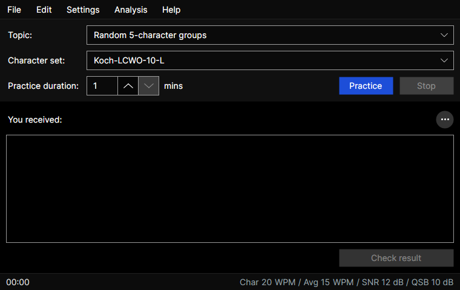

The application always uses its dark theme, whatever the theme of your system.

From top to bottom:

- **Menu:** File (export, import, restore, exit), Edit (undo, redo, cut, copy, paste, select all in the copy box), Settings (Morse settings, UI settings), Analysis (Trends, Confusions, Correlation), Help (Check updates, About).
- **Topic:** what the session sends: random groups, callsigns, cities, names, abbreviations, your own text, or all of them mixed (see [chapter 5](#5-what-to-practise-topics)).
- **Character set:** the characters the random groups are drawn from. It is enabled only for the *Random 5-character groups* and *Mixed* topics.
- **Practice duration:** the length of the session in minutes. Disabled for the custom text topic, which always sends the whole text.
- **Practice / Stop:** starts the session; Stop ends it early.
- **You received:** the box you type into while listening. The round **⋯** button next to it opens the Morse settings.
- **Check result:** scores the copy and opens the result window.
- **Status bar:** on the left, the countdown and the state of the session; on the right, the speed the **next** session will use (`Char 20 WPM / Avg 15 WPM`) and, while noise or QSB is on, the signal-to-noise ratio and the fade depth it will use (`/ SNR 12 dB / QSB 10 dB`). With auto-adjust these change after every saved session.

## 3. A practice session step by step

1. Choose a **topic** and, for groups, a **character set**.
2. Set the **duration**.
3. Press **Practice**. Every session starts with `vvv =` so you can tune your ear, then the text follows, and it ends with `<ar>`.
4. Type what you hear into the box. You can type in lowercase; case does not matter. Separate the groups with spaces; for multi-word items an ordinary space is fine.
5. When the time is up (or you press **Stop**) the status bar says *Practice completed!*

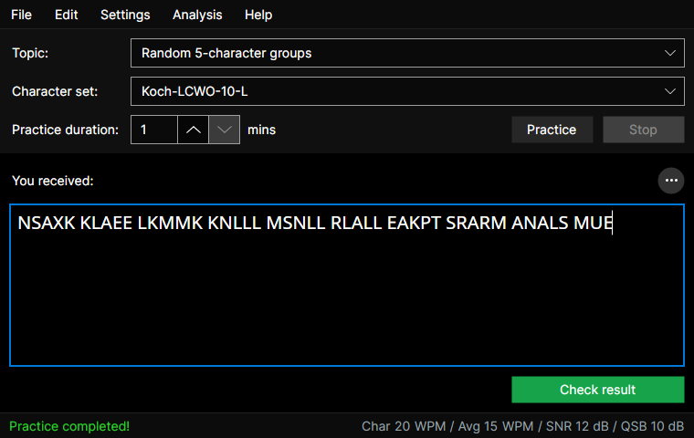

6. Press **Check result**. The result window opens ([chapter 4](#4-reading-the-result)).
7. In the result window press **Save results** to keep the session in your statistics. **Only saved sessions count**: they feed the trends, the correlation, the confusion matrix and the auto-adjust. A session can be saved once; correcting the copy after saving does not save it again.

After saving, the status bar shows what the next session will use. In the picture below auto-adjust moved the average speed from 15 to 16 WPM and lowered the signal-to-noise ratio from 12 to 9 dB after a successful session:

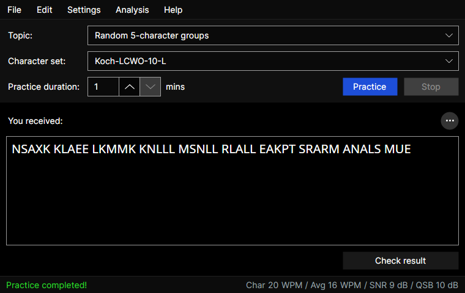

If **Reveal sent text after practice** is on in the UI settings and you typed nothing, the box is filled with the sent text when the session ends, so you can compare.

## 4. Reading the result

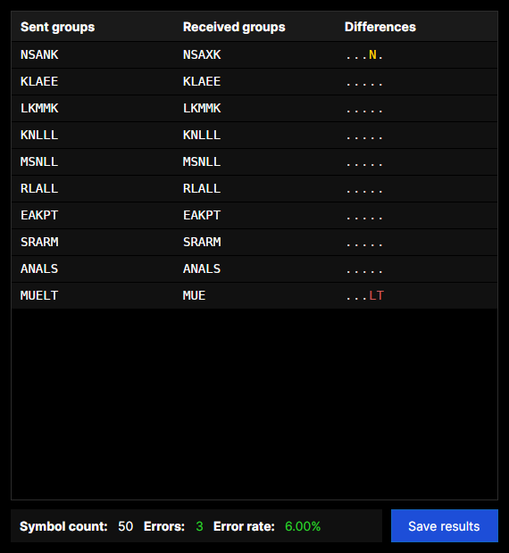

Each row is one item: a group, a callsign, or a whole multi-word item such as `NEW YORK`. The columns:

- **Sent groups:** what was sent.
- **Received groups:** what you typed, matched to the sent items.
- **Differences:** character by character:
  - `.` (grey): correct;
  - **gold** letter: you typed a different character here; the sent one is shown;
  - **red** letter: you missed this sent character;
  - **green** letter: you typed an extra character that was not sent.

At the bottom:

- **Symbol count:** the number of sent characters (a prosign such as `<ar>` is one symbol).
- **Errors:** the total [Levenshtein distance](https://en.wikipedia.org/wiki/Levenshtein_distance) of your copy, item by item: every missing, extra or wrong character is one error.
- **Error rate:** errors ÷ symbol count × 100 %. The session **passes** when this is at or below the error threshold set in the Morse settings (10 % by default); the rate is shown in red when the session failed.

In the example, the fourth character of the first group was copied wrongly (one substitution, in gold) and the last two characters of the last group were missed (two deletions, in red): 3 errors out of 50 symbols, 6 %, below the 10 % threshold, so the session passed.

## 5. What to practise: topics

| Topic | What is sent | Repeated by default |
|-----|---------|----|
| Random 5-character groups | Groups drawn from the selected character set | never |
| Callsigns (EMEA) | Callsigns generated from European, African and Middle-Eastern patterns | 2× |
| Callsigns (global) | Callsigns from worldwide patterns | 2× |
| Cities | City names (some of several words, such as `NEW YORK`) | 2× |
| Names | First names | 2× |
| Abbreviations & Q-codes | Ham abbreviations and Q-codes (`QSL VIA BURO`, `TNX`, `QRZ`) | 1× |
| Custom text | Your own text, line by line | 1× |
| Mixed | Every item from a random source among all of the above | as its own topic |

**Amount:** word topics send as many letters as the groups of the chosen duration would; the custom text is always sent whole.

**Repetition, as in a real QSO:** every item is sent a random number of times in a row, between a minimum and a maximum you set. You copy it **once**: `LACI LACI NEW YORK NEW YORK` is copied as `LACI NEW YORK`. The repetitions help you hear the item; the check, the revealed text and the result show it once.

**Multi-word items** (`NEW YORK`, `LITTLE JOHN`, `QSL VIA BURO`) are one item: type them with ordinary spaces; the result shows them in one row and still scores them word by word.

**Practice confusions** (in the Confusions window) switches the topic back to random groups with a character set built from your most confused characters ([chapter 9](#confusions)).

The lists are edited in the Morse settings, on the Topics tab.

## 6. Morse settings

Open with **Settings › Morse settings** or the **⋯** button. Nothing changes until you press **Save**; **Cancel** discards everything. The line at the bottom left warns when the current audio settings would drive the sound past full scale (distortion), with the peak level and how much of the signal would clip: lower the volume or raise the signal-to-noise ratio to clear it.

### Practice tab

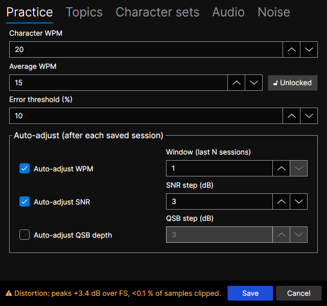

- **Character WPM:** how fast each character is keyed (PARIS standard).
- **Average WPM:** the overall speed with the gaps. Below the character WPM it adds extra space between characters while keeping each character fast: the **Farnsworth method**, the best way to learn characters by their sound instead of counting dits and dahs. The **Locked / Unlocked** toggle button ties the two together.
- **Error threshold (%):** the highest error rate at which a session passes. It also decides the auto-adjust.
- **Auto-adjust (after each saved session):** see [chapter 7](#7-automatic-difficulty-auto-adjust).

### Topics tab

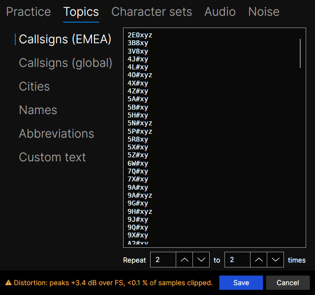

One sub-tab per list, one entry per line; the lists are kept in alphabetical order without repeats. Below each list, **Repeat N to M times** sets the repetition (1 to 9).

**Callsign patterns:** `#` is a random digit, a lowercase letter a random letter; uppercase letters, digits and `/` are sent as written. `HA#xyz` gives e.g. `HA5ABC`; `2E0xyz` gives `2E0` plus three random letters.

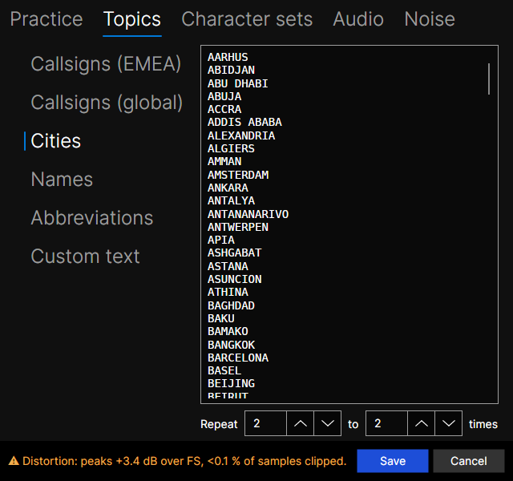

Cities, names and abbreviations: one entry per line; an entry may contain several words.

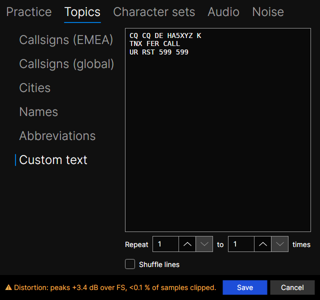

**Custom text:** each non-empty line is one item, sent and repeated as a whole. **Shuffle lines** sends the lines in random order. Write one word per line to shuffle words.

Everything in the lists must be sendable as Morse code; an entry that is not is rejected when you save, with the reason.

### Character sets tab

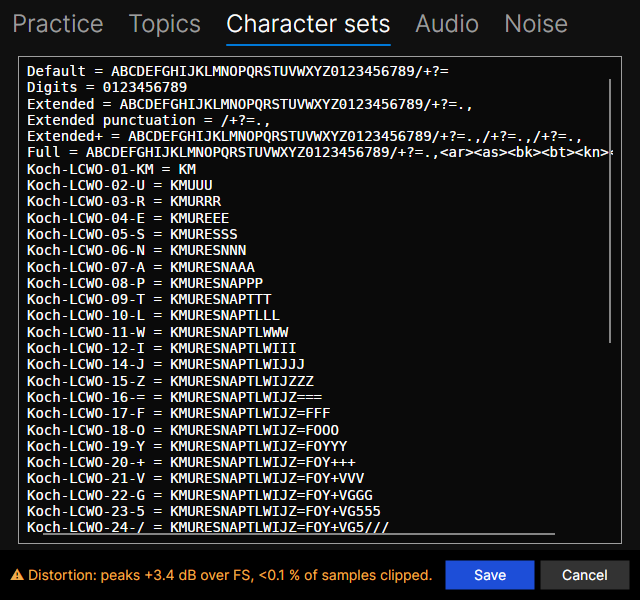

One set per line: `name = characters`. Prosigns are written as `<ar>`, `<as>`, `<bk>`, `<bt>`, `<kn>`, `<sk>`. The built-in sets:

- `Default` (A–Z, 0–9, `/+?=`), `Letters`, `Digits`, `Punctuation`, `Full` (with the prosigns);
- the **Koch / LCWO progression**, `Koch-LCWO-01-KM` to `Koch-LCWO-40-…`, numbered as on [LCWO](https://lcwo.net). Level 13 does not exist on purpose, so there are 39 Koch sets. The classic method: start at level 1 at your target character speed, and move to the next level when you copy 90 % (an error threshold of 10 %).

### Audio tab

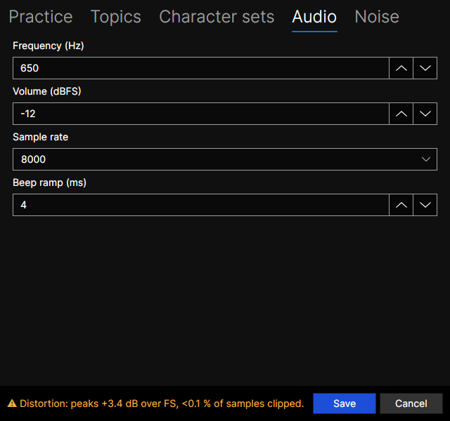

- **Frequency (Hz):** the pitch of the tone; 600–700 Hz is typical.
- **Volume (dBFS):** 0 is full scale, negative values are quieter.
- **Sample rate:** higher is smoother; for CW there is no audible difference.
- **Beep ramp (ms):** the soft start and end of each tone, against clicks.

### Noise tab: a simulated receiver

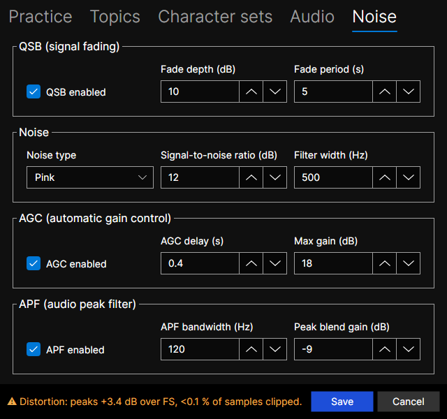

Real signals are never clean. The Noise tab simulates a receiver:

- **QSB (signal fading):** the signal strength wanders down and recovers like a sky-wave signal. **Fade depth** is how deep it can fade (10 dB ≈ 3× weaker), **fade period** roughly how long one fade takes. QSB works with the noise off too.
- **Noise:** the **type** (None, Gaussian, Uniform, Pink), the **signal-to-noise ratio** in dB (higher is cleaner; it can be negative: the signal under the noise), and the **filter width** of the receiver's band-pass filter (narrower lets less noise through).
- **AGC (automatic gain control):** rides the level like a real receiver, so the noise swells up in the gaps between characters. **AGC delay** is how slowly it recovers; **max gain** limits the swell.
- **APF (audio peak filter):** adds a narrow resonant peak on the tone, the typical CW "ring" that makes the tone stand out of the noise. **APF bandwidth** is its width, **peak blend gain** how strong it is (−9 dB is subtle, 0 dB very strong).

The order inside: the tone is faded (QSB), mixed with the noise, filtered, levelled by the AGC, and finally the APF peak is added.

## 7. Automatic difficulty (auto-adjust)

In the **Auto-adjust (after each saved session)** group of the Practice tab you can let the application keep you at the edge of your ability.

After every **saved** session one decision is made: **harder** or **easier**.

1. The error rates of the last **N** saved sessions are averaged (**Window (last N sessions)**; N = 1 means the last session only).
2. If the average is **above** the error threshold, practice gets **easier**.
3. If it is at or below, practice gets **harder**, **unless the session you just finished failed on its own**: a fresh failure always makes it easier, even when the average still looks good.

That one decision moves every quantity you switched on:

| Option | Harder | Easier | Step |
|-----|------|---|-----|
| Auto-adjust WPM | average speed +1 WPM (the character speed rises with it when they meet) | −1 WPM | 1 WPM |
| Auto-adjust SNR | signal-to-noise ratio − step (more noise) | + step | **SNR step (dB)**, 3 dB by default |
| Auto-adjust QSB depth | fade depth + step (deeper fades) | − step | **QSB step (dB)**, 3 dB by default |

The SNR moves only while noise is on, the QSB depth only while QSB is on. The levels stay within the ranges of the Noise tab (SNR −20…80 dB, depth 1…40 dB).

All three live **in memory only**: the settings are not overwritten, and every start of the application (and every Save in the settings) restarts them from the values you configured. The status bar always shows what the next session will use, and the saved statistics record what was actually played.

## 8. UI settings

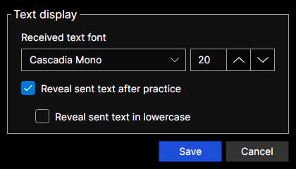

- **Received text font** and size: the font of the box you type into. A monospace font keeps the groups aligned; the default, Cascadia Mono, tells `0` and `O` apart.
- **Reveal sent text after practice:** if you typed nothing, the box is filled with the sent text at the end of the session.
- **Reveal sent text in lowercase:** the revealed text in lowercase (prosigns stay as they are).

## 9. Analysis: trends, correlation, confusions

All three windows read your **saved** sessions.

### Trends

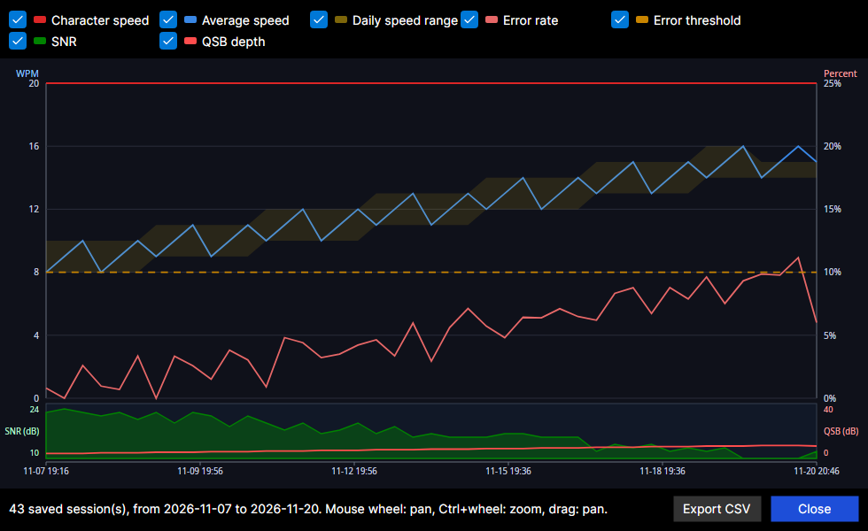

Every saved session on a time axis:

- top chart, left axis (WPM): **character speed**, **average speed**, and the shaded **daily speed range**: for each day, from the slowest to the fastest average speed among that day's **passed** sessions (missing on days without a pass);
- top chart, right axis (%): **error rate** and **error threshold** (each session's own threshold);
- bottom strip: **SNR** and **QSB depth**.

Each series can be switched off with its checkbox. The mouse wheel pans, Ctrl + wheel zooms, dragging pans. **Export CSV** saves every session to a CSV file for your own spreadsheets.

### Correlation

What makes you make mistakes? The correlation window answers this with three tabs. Each plots one dot per saved session: the error rate against **speed**, against the **signal-to-noise ratio** (only sessions with noise) or against the **QSB depth** (only sessions with QSB).

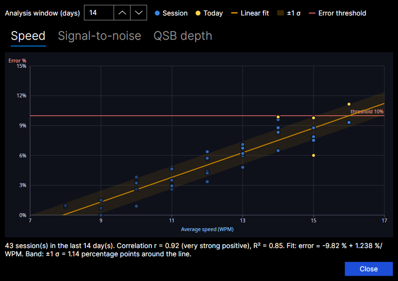

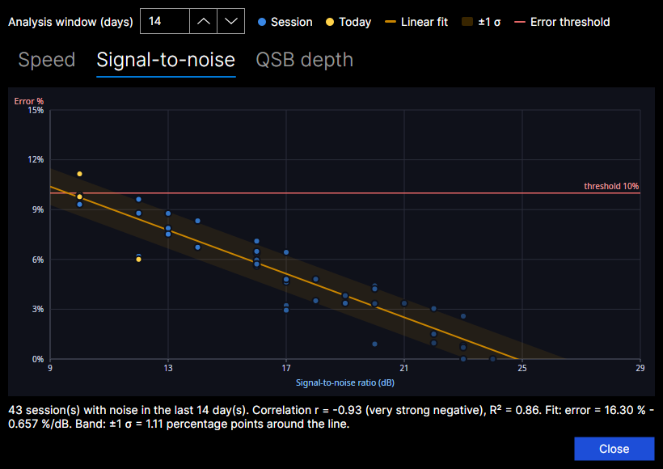

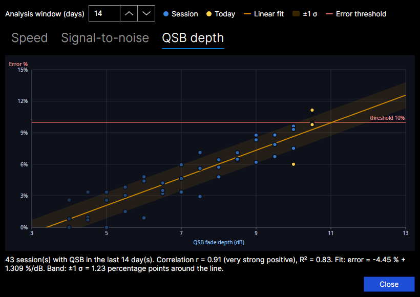

How to read it:

- **Analysis window (days):** how many days back to look; **0 shows today only** (from midnight). Shared by the three tabs and remembered.
- **Dots:** blue dots fade with age (the oldest in the window is the faintest); **today's** sessions are **yellow**. Hovering a dot shows its time, value and error rate.
- **Linear fit** (amber line): the least-squares line of error rate on the quantity; the shaded **±1 σ** band holds roughly two thirds of the sessions.
- **Error threshold** (red line): the threshold currently set.
- **Summary** under the chart: the number of sessions, the Pearson correlation **r** (−1…1, with a word for its strength), **R²** (how much of the variation the line explains), and the fitted line: e.g. `error = 17.94 % − 0.702 %/dB` means every dB of extra SNR costs about 0.7 percentage points less error.

The fit needs at least two sessions with different values and different error rates; otherwise the summary says why there is no line.

### Confusions

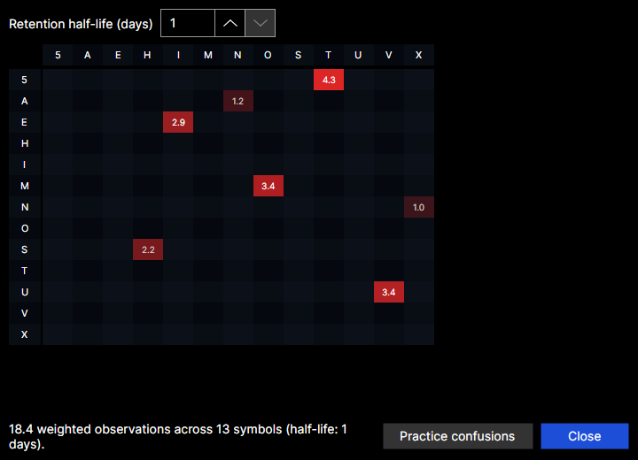

Which characters do you mix up? Rows are the characters **sent**, columns what you **typed** instead; the number in a cell is how often, weighted by age. The **retention half-life (days)** sets how fast old mistakes fade: a confusion this many days old counts half.

**Practice confusions** builds a character set from your most confused characters (named *Practice confusions*), selects it and switches the topic to random groups, so the next session drills exactly those.

## 10. Backup: export, import, restore

- **File › Export** saves your settings and every saved session into one `.prmt` file (`pentagrammata-backup-YYYY-MM-DD.prmt`). Window sizes are not included.
- **File › Import** loads such a file on any computer. It checks the file, asks for confirmation, then replaces the settings and the statistics **immediately**, without a restart. Before replacing anything it saves your current data into the `backups` folder of your profile, and tells you where.
- **File › Restore** brings back the data saved before the most recent import (and keeps the data it replaces in another backup).

## 11. Updates and the About window

**Help › Check updates** asks GitHub whether a newer stable release exists. **Help › About** shows the version, the features and the license:

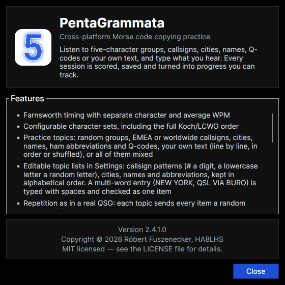

## 12. A training plan

1. Set the **character speed** to your target (20–25 WPM) and the **average speed** well below it (10–15 WPM).
2. Start with **Koch-LCWO-01-KM** and an **error threshold of 10 %**.
3. Practise 5-minute sessions and **save** each. When you pass reliably, move to the next Koch level.
4. Turn on **Auto-adjust WPM** with a window of 3: the average speed will follow your form.
5. When the letters are solid, switch to **callsigns**, **names** and **abbreviations**: these are what you will hear on the air.
6. Turn on **noise** (Pink, SNR around 15 dB) and **QSB**, and let **auto-adjust SNR / QSB depth** harden the conditions gradually.
7. Look at the **correlation** window weekly: the slope tells you whether speed or noise is your weak point, the **confusions** window which characters to drill.

---

## 13. Under the hood: the code

PentaGrammata is a .NET 10 / [Avalonia](https://avaloniaui.net) desktop application written in the MVVM pattern. This chapter maps what you have seen above to the source code.

### Building and testing

```bash
dotnet build src/PentaGrammata.csproj
dotnet run --project src/PentaGrammata.csproj
# unit tests
dotnet test tests/PentaGrammata.Tests/PentaGrammata.Tests.csproj
# the whole UI, headless
dotnet test tests/PentaGrammata.Headless.Tests/PentaGrammata.Headless.Tests.csproj
```

The headless tests drive the real windows as a user would: they click, type, open dialogs, render frames. The pictures in this guide are rendered by one of them (see [docs/README.md](../README.md)).

### The layers

```
src/
  Views/           Avalonia AXAML windows and their thin code-behind
  ViewModels/      state and commands of each window (CommunityToolkit.Mvvm)
  Presentation/    opening dialogs, pickers and windows
  Services/        the business logic
  Players/         audio: Morse rendering, platform players, noise and DSP
  Stores/          persistence: settings, statistics database, window sizes
  Interfaces/      the abstractions everything is injected through
  Models/          plain data records
  Configuration/   the settings classes (what is in settings.prmt)
  Composition/     dependency-injection registration
tests/
  PentaGrammata.Tests/           unit tests (MSTest + NSubstitute)
  PentaGrammata.Headless.Tests/  user journeys through the real UI
```

Every service is registered in `Composition/ServiceCollectionExtensions.cs`; the container is built in `App.axaml.cs` (which also forces the dark theme). A view model never touches a store directly, only services through interfaces.

### From the main window to the result

| What you see | Where it lives |
|------|--------------|
| Main window, menu, status bar | `Views/MainWindow.axaml`, `ViewModels/MainWindowViewModel.cs`, `ViewModels/PracticeViewModel.cs` |
| Practice button, countdown, Check result | `PracticeViewModel` → `Services/PracticeController.cs` |
| The text of a session | `Services/PracticeTextGeneratorFactory.cs` picks the generator of the topic; groups come from `IMorseGenerator`, callsigns from the patterns, repetition and multi-word joining from `Services/PracticeItems.cs` |
| Morse audio | `Players/MorsePlayer.cs` renders the tone with Farnsworth timing (`MorseSignalRenderer`), adds QSB (`QsbFader`), noise, band-pass filter, AGC and APF (`BandPassFilter`, `AutomaticGainControl`, the noise generators); `AudioPlayerFactory` picks `WindowsAudioPlayer` (NAudio), `LinuxAudioPlayer` or `MacOSAudioPlayer` |
| Distortion warning in the settings | `Services/AudioHeadroomAnalyzer.cs` |
| Scoring | `Services/PracticeResultEvaluator.cs`: Levenshtein distance item by item and the diff segments; `Services/ConfusionObservationExtractor.cs` turns the mistakes of a saved session into confusion observations |
| Result window | `Views/PracticeResultWindow.axaml`, `ViewModels/PracticeResultWindowViewModel.cs` |
| Saving a session | `Stores/PracticeResultStatisticsStore.cs` (SQLite, `practice-results.db`) behind `IPracticeResultStatisticsService` |
| Auto-adjust | `PracticeController.RecordSavedResult` asks `Services/DynamicDifficultyAdjuster.cs` for one harder/easier decision and moves the WPM, SNR and QSB depth |

A session in one sentence: `PracticeController.StartAsync` asks the topic's generator for text, splits it into what is **played** (every repetition) and what is **checked** (each item once), hands the played text to the `MorsePlayer` with the speeds and receiver levels of this session, and keeps the checked text for `BuildResultAsync`, which the result window shows and saves.

### Settings and persistence

| What | Where |
|------|--------------|
| Settings classes | `Configuration/` (`AppConfiguration`, `Practice`, `Audio`, `NoiseSettings`, `Topics`, `Analytics`, `UiPreferences`); every property has a `[PromptuariumComment]` with its unit |
| Loading and saving `settings.prmt` | `Stores/ConfigurationStore.cs`; the bundled defaults are `src/settings.prmt`, your file is layered onto them |
| The live settings | `Services/ConfigurationService.cs` (`IConfigurationService.Current`) |
| Validation | `Services/PracticeSettingsValidator.cs` |
| Morse settings dialog | `Views/MorseSettingsDialog.axaml`, `ViewModels/MorseSettingsDialogViewModel.cs` |
| Window sizes | `Stores/WindowSizeStore.cs` (`windows.prmt`) |
| Export, import, restore | `Services/UserBackupService.cs`, `Services/BackupArchive.cs` (the PPAK1-LE archive format) |

### Analysis

| Window | View model | Analysis | Chart |
|---|-----|------|-----|
| Trends | `TrendsDialogViewModel` | the daily speed range in the view model; CSV in `Services/PracticeStatisticsCsvExporter.cs` | `Views/Controls/TrendsTimelineChart.cs` |
| Correlation | `CorrelationDialogViewModel` + one `CorrelationTabViewModel` per tab | `Services/CorrelationAnalysisService.cs` (window, least squares, Pearson r, residual σ) per `CorrelationAxis` | `Views/Controls/CorrelationScatterChart.cs` |
| Confusions | `ConfusionsDialogViewModel` | `Services/ConfusionAnalysisService.cs` (half-life weighting, the *Practice confusions* set) | a grid of cells in `Views/ConfusionsDialog.axaml` |

The charts are custom Avalonia controls that draw with a `DrawingContext`; the analysis services are pure functions of the saved records, which is why they are unit tested without any UI.

### Where to read further

- `AGENTS.md` at the repository root: the exact rules of every feature (it is the specification the code follows).
- `README.md`: the full table of settings with defaults and units.
- `RELEASE_NOTES.md`: what changed in each version.
