# PentaGrammata felhasználói kézikönyv

A PentaGrammata morzevétel-gyakorló program. Hangként küldi a morzejeleket, te begépeled, amit hallasz, a kör végén pedig kiértékeli a vételt, megmutat minden hibát, és megőrzi az eredményeidet, hogy hetekre visszamenőleg követhesd a fejlődésedet.

Ez a kézikönyv ablakról ablakra bemutatja a program minden funkcióját, az utolsó fejezete pedig a kód felépítését írja le, így annak is kiindulópont, aki olvasni vagy módosítani szeretné a forráskódot.

> English version: [../en/user-guide.md](../en/user-guide.md)

## Tartalom

1. [Telepítés és indítás](#1-telepítés-és-indítás)
2. [A főablak](#2-a-főablak)
3. [Egy gyakorlókör lépésről lépésre](#3-egy-gyakorlókör-lépésről-lépésre)
4. [Az eredmény értelmezése](#4-az-eredmény-értelmezése)
5. [Mit gyakorolj: témák](#5-mit-gyakorolj-témák)
6. [Morze-beállítások](#6-morze-beállítások)
7. [Automatikus nehézség (auto-adjust)](#7-automatikus-nehézség-auto-adjust)
8. [Felület-beállítások](#8-felület-beállítások)
9. [Elemzés: trendek, korreláció, tévesztések](#9-elemzés-trendek-korreláció-tévesztések)
10. [Mentés: export, import, visszaállítás](#10-mentés-export-import-visszaállítás)
11. [Frissítések és a Névjegy ablak](#11-frissítések-és-a-névjegy-ablak)
12. [Egy edzésterv](#12-egy-edzésterv)
13. [A motorháztető alatt: a kód](#13-a-motorháztető-alatt-a-kód)

A program felülete angol nyelvű; a kézikönyv a gombokat, menüket és mezőket az eredeti, angol nevükön említi, **félkövérrel**.

---

## 1. Telepítés és indítás

Minden kiadás telepítői a [GitHub releases oldalon](https://github.com/fuszenecker/PentaGrammata/releases) vannak:

| Rendszer | Fájl | Megjegyzés |
|------|----------|--------|
| Windows | `PentaGrammata-<verzió>-win-x64-setup.exe` | Választható, kérsz-e Start menü és asztali parancsikont. |
| Debian, Ubuntu | `pentagrammata_<verzió>_amd64.deb` | A szoftverközpont névvel és MIT licenccel mutatja. |
| Fedora, openSUSE | `pentagrammata-<verzió>-1.x86_64.rpm` | |
| macOS (Apple silicon) | `PentaGrammata-<verzió>-osx-arm64.dmg` | A hang a rendszer AudioToolboxán megy, mást nem kell telepíteni. |

A beállítások és az eredmények felhasználónként tárolódnak:

- **Windows:** `%LocalAppData%\PentaGrammata` (a `%AppData%\PentaGrammata` is beolvasásra kerül).
- **Linux:** `$XDG_CONFIG_HOME/PentaGrammata`, általában `~/.config/PentaGrammata`.

Itt három fájl van: `settings.prmt` (a beállítások), `windows.prmt` (az ablakméretek) és `practice-results.db` (minden mentett kör). A `.prmt` fájlok [Promptuarium](https://github.com/fuszenecker/Promptuarium) konténerek; minden értékükhöz megjegyzés tartozik, így a Promptuarium `pedit`/PStudio eszközével olvashatók.

Ha a beállításfájlt a program egy másik **fő** (major) verziója írta, nem töltődik be: átkerül a mellette lévő `backups` mappába, a program az alapértékekkel indul, és a főablak megmondja, hová került a régi fájl.

## 2. A főablak

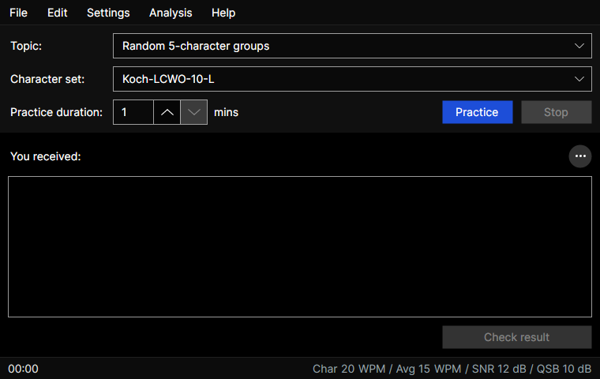

A program mindig sötét témát használ, a rendszer témájától függetlenül.

Fentről lefelé:

- **Menü:** File (export, import, visszaállítás, kilépés), Edit (visszavonás, újra, kivágás, másolás, beillesztés, mindent kijelöl a vételmezőben), Settings (Morse settings, UI settings), Analysis (Trends, Confusions, Correlation), Help (Check updates, About).
- **Topic:** mit küld a kör: véletlen csoportokat, hívójeleket, városokat, neveket, rövidítéseket, saját szöveget, vagy mindezt keverve (lásd [5. fejezet](#5-mit-gyakorolj-témák)).
- **Character set:** a karakterkészlet, amelyből a véletlen csoportok készülnek. Csak a *Random 5-character groups* és a *Mixed* témánál aktív.
- **Practice duration:** a kör hossza percben. A saját szöveg (Custom text) témánál nem állítható, mert az mindig a teljes szöveget küldi.
- **Practice / Stop:** elindítja a kört; a Stop idő előtt befejezi.
- **You received:** ide gépeled, amit hallasz. A mellette lévő kerek **⋯** gomb a Morze-beállításokat nyitja meg.
- **Check result:** kiértékeli a vételt és megnyitja az eredményablakot.
- **Állapotsor:** bal oldalt a visszaszámlálás és a kör állapota; jobb oldalt a **következő** kör sebessége (`Char 20 WPM / Avg 15 WPM`), és ha a zaj vagy a QSB be van kapcsolva, a következő kör jel/zaj viszonya és fadingmélysége (`/ SNR 12 dB / QSB 10 dB`). Auto-adjust mellett ezek minden mentett kör után változnak.

## 3. Egy gyakorlókör lépésről lépésre

1. Válassz **témát** (Topic), csoportoknál **karakterkészletet** (Character set) is.
2. Állítsd be az **időtartamot** (Practice duration).
3. Nyomd meg a **Practice** gombot. Minden kör `vvv =` jelekkel kezdődik, hogy ráhangolódhass, utána jön a szöveg, a végén pedig `<ar>`.
4. Gépeld be, amit hallasz. Kisbetűvel is írhatsz, a kis- és nagybetű nem számít. A csoportokat szóközzel válaszd el; több szóból álló tételeknél is elég a sima szóköz.
5. Amikor lejár az idő (vagy megnyomod a **Stop** gombot), az állapotsoron megjelenik: *Practice completed!*

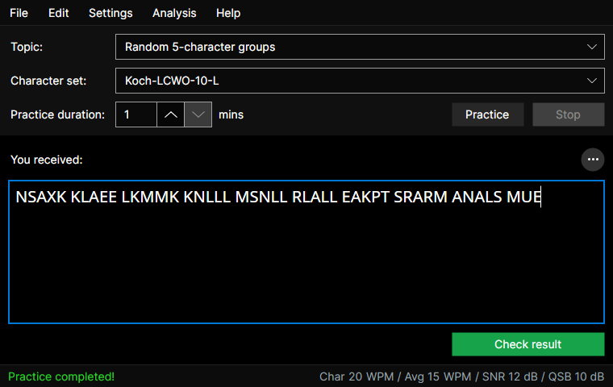

6. Nyomd meg a **Check result** gombot. Megnyílik az eredményablak ([4. fejezet](#4-az-eredmény-értelmezése)).
7. Az eredményablakban a **Save results** gombbal mentheted a kört a statisztikádba. **Csak a mentett körök számítanak**: ezekből készülnek a trendek, a korreláció, a tévesztési mátrix, és ezek vezérlik az auto-adjustot. Egy kör egyszer menthető; ha mentés után javítod a vételt, az már nem mentődik újra.

Mentés után az állapotsor azt mutatja, amivel a következő kör megy. Az alábbi képen egy sikeres kör után az auto-adjust 15-ről 16 WPM-re emelte az átlagsebességet, és 12-ről 9 dB-re csökkentette a jel/zaj viszonyt:

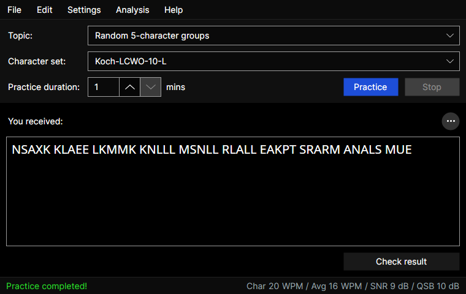

Ha a felület-beállításokban be van kapcsolva a **Reveal sent text after practice**, és nem gépeltél semmit, a kör végén a vételmezőbe bekerül az elküldött szöveg, hogy összevethesd.

## 4. Az eredmény értelmezése

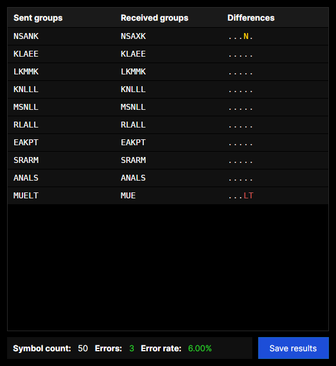

Minden sor egy tétel: egy csoport, egy hívójel, vagy egy teljes, több szóból álló tétel, például `NEW YORK`. Az oszlopok:

- **Sent groups:** amit a program küldött.
- **Received groups:** amit begépeltél, a küldött tételekhez igazítva.
- **Differences:** karakterenként:
  - `.` (szürke): helyes;
  - **arany** betű: itt más karaktert gépeltél; a küldött látszik;
  - **piros** betű: ezt a küldött karaktert kihagytad;
  - **zöld** betű: fölösleges karaktert gépeltél, amit nem küldtek.

Alul:

- **Symbol count:** a küldött karakterek száma (egy prosign, például `<ar>`, egy jelnek számít).
- **Errors:** a vétel teljes [Levenshtein-távolsága](https://hu.wikipedia.org/wiki/Levenshtein-t%C3%A1vols%C3%A1g) tételenként: minden hiányzó, fölösleges vagy rossz karakter egy hiba.
- **Error rate:** hibák ÷ jelek száma × 100 %. A kör **sikeres**, ha ez legfeljebb akkora, mint a Morze-beállításokban megadott hibaküszöb (alapból 10 %); sikertelen körnél pirossal látszik.

A példában az első csoport negyedik karaktere hibásan került be (egy csere, aranyszínnel), az utolsó csoport utolsó két karaktere pedig kimaradt (két törlés, pirossal): 50 jelből 3 hiba, 6 %, ez a 10 %-os küszöb alatt van, tehát a kör sikeres.

## 5. Mit gyakorolj: témák

| Téma (Topic) | Mit küld | Alapértelmezett ismétlés |
|-----|---------|----|
| Random 5-character groups | Csoportok a kiválasztott karakterkészletből | soha |
| Callsigns (EMEA) | Európai, afrikai és közel-keleti minták alapján generált hívójelek | 2× |
| Callsigns (global) | Hívójelek az egész világ mintáiból | 2× |
| Cities | Városnevek (némelyik több szóból, pl. `NEW YORK`) | 2× |
| Names | Keresztnevek | 2× |
| Abbreviations & Q-codes | Rádióamatőr rövidítések és Q-kódok (`QSL VIA BURO`, `TNX`, `QRZ`) | 1× |
| Custom text | A saját szöveged, soronként | 1× |
| Mixed | Minden tétel véletlen forrásból a fentiek közül | a saját témája szerint |

**Mennyiség:** a szavas témák annyi betűt küldenek, amennyit a beállított időtartam csoportjai küldenének; a saját szöveg mindig teljes egészében elmegy.

**Ismétlés, mint egy valódi QSO-ban:** minden tétel véletlen számú alkalommal hangzik el egymás után, a megadott minimum és maximum között. Te **egyszer** veszed: a `LACI LACI NEW YORK NEW YORK` vétele `LACI NEW YORK`. Az ismétlés a hallást segíti; az ellenőrzés, a felfedett szöveg és az eredmény egyszer mutatja a tételt.

**Több szóból álló tételek** (`NEW YORK`, `LITTLE JOHN`, `QSL VIA BURO`): egy tételnek számítanak. Sima szóközökkel gépeld be őket; az eredményben egy sorban látszanak, de az értékelés szavanként történik.

A **Practice confusions** gomb (a Confusions ablakban) visszaváltja a témát véletlen csoportokra, egy olyan karakterkészlettel, amely a legtöbbször tévesztett karaktereidből áll ([9. fejezet](#tévesztések-confusions)).

A listák a Morze-beállítások Topics fülén szerkeszthetők.

## 6. Morze-beállítások

Megnyitás: **Settings › Morse settings** vagy a **⋯** gomb. Semmi sem változik, amíg meg nem nyomod a **Save** gombot; a **Cancel** mindent elvet. A bal alsó sor figyelmeztet, ha a jelenlegi hangbeállítások mellett a hang túllépné a maximális szintet (torzítás); kiírja a csúcsszintet és azt is, hogy a jel mekkora része vágódna le. Ilyenkor csökkentsd a hangerőt vagy növeld a jel/zaj viszonyt.

### Practice fül

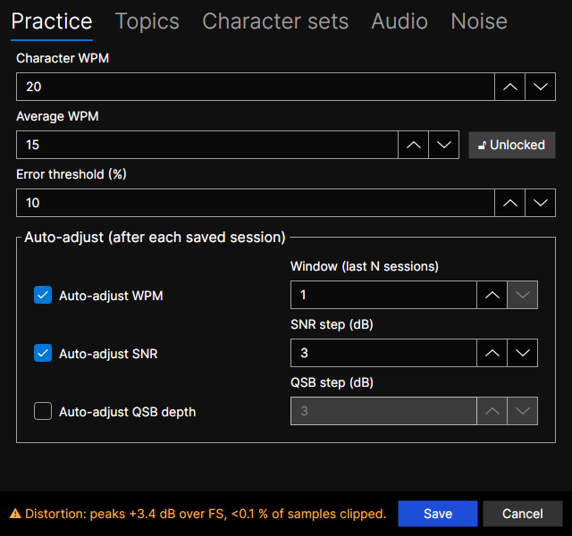

- **Character WPM:** milyen gyorsan adja a program az egyes karaktereket (PARIS szabvány szerint).
- **Average WPM:** az összesített sebesség a szünetekkel együtt. Ha kisebb a karaktersebességnél, a karakterek közé több szünet kerül, miközben maguk a karakterek gyorsak maradnak: ez a **Farnsworth-módszer**, a legjobb módja annak, hogy a karaktereket a hangképükről ismerd fel, és ne a pontokat-vonásokat számold. A **Locked / Unlocked** kapcsológomb összeköti a kettőt.
- **Error threshold (%):** a legnagyobb hibaarány, amellyel egy kör még sikeres. Ez dönt az auto-adjustnál is.
- **Auto-adjust (after each saved session):** lásd [7. fejezet](#7-automatikus-nehézség-auto-adjust).

### Topics fül

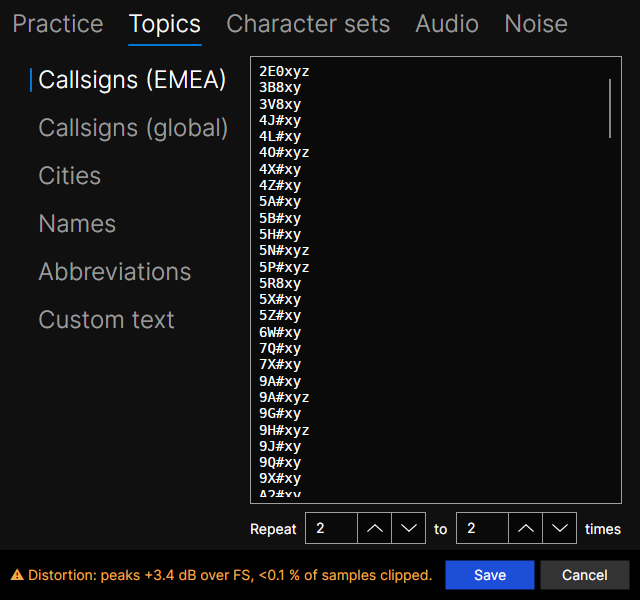

Minden listának saját alfüle van, soronként egy bejegyzéssel; a listák ábécérendben, ismétlődés nélkül tárolódnak. Minden lista alatt a **Repeat N to M times** sor adja meg az ismétlést (1-től 9-ig).

**Hívójelminták:** a `#` egy véletlen számjegy, egy kisbetű egy véletlen betű; a nagybetűk, a számjegyek és a `/` úgy mennek, ahogy írva vannak. A `HA#xyz` ebből lesz például `HA5ABC`; a `2E0xyz` a `2E0` után három véletlen betűt ad.

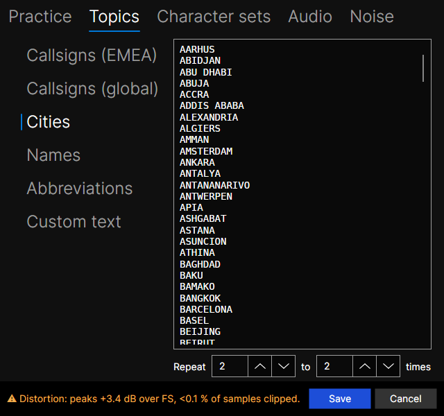

Városok, nevek, rövidítések: soronként egy bejegyzés; egy bejegyzés több szóból is állhat.

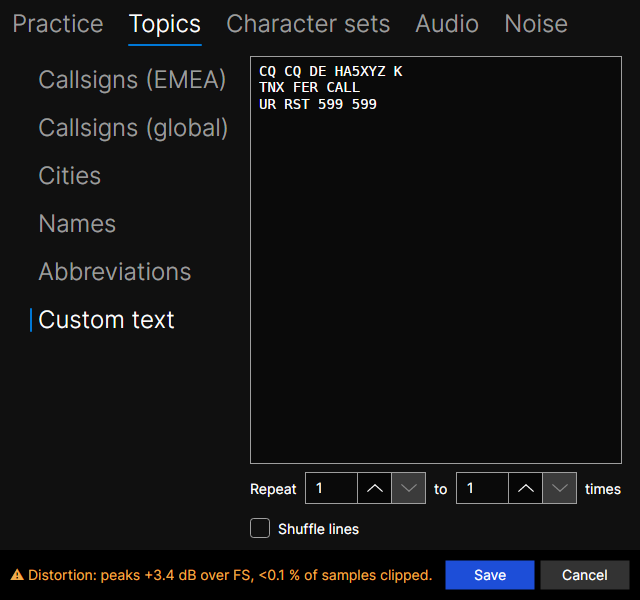

**Custom text (saját szöveg):** minden nem üres sor egy tétel, amely egészében megy el és egészében ismétlődik. A **Shuffle lines** véletlen sorrendben küldi a sorokat. Ha szavakat szeretnél keverni, írj soronként egy szót.

A listákban mindennek morzejelként elküldhetőnek kell lennie; ami nem az, azt a program mentéskor indoklással visszautasítja.

### Character sets fül

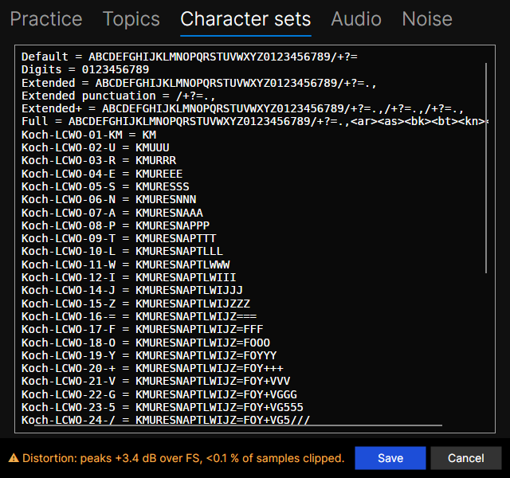

Soronként egy készlet: `név = karakterek`. A prosignok írásmódja: `<ar>`, `<as>`, `<bk>`, `<bt>`, `<kn>`, `<sk>`. A beépített készletek:

- `Default` (A–Z, 0–9, `/+?=`), `Letters`, `Digits`, `Punctuation`, `Full` (a prosignokkal együtt);
- a **Koch / LCWO sorozat**, `Koch-LCWO-01-KM`-től `Koch-LCWO-40-…`-ig, az [LCWO](https://lcwo.net) számozása szerint. A 13. szint szándékosan hiányzik, így 39 Koch-készlet van. A klasszikus módszer: az 1. szinttel kezdj a célként kitűzött karaktersebességen, és akkor lépj a következő szintre, amikor 90 %-ot veszel (10 %-os hibaküszöb).

### Audio fül

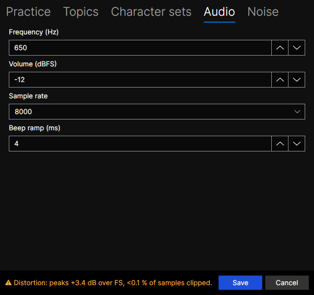

- **Frequency (Hz):** a hang magassága; 600–700 Hz a szokásos.
- **Volume (dBFS):** 0 a maximális szint, a negatív értékek halkabbak.
- **Sample rate:** a mintavételi frekvencia; magasabb értéknél simább a hang, de CW-nél nem hallható a különbség.
- **Beep ramp (ms):** az egyes hangok lágy fel- és lefutása, a kattogás ellen.

### Noise fül: szimulált vevő

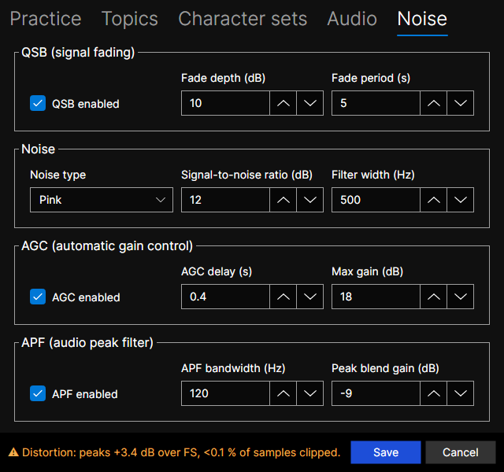

A valódi jelek sosem tiszták. A Noise fül egy vevőt szimulál:

- **QSB (fading):** a jelerősség rendszertelenül lecsökken és visszatér, mint egy ionoszférikus terjedésű jelnél. A **Fade depth** a legmélyebb elhalkulás (10 dB ≈ 3× gyengébb), a **Fade period** nagyjából egy fadingciklus hossza. A QSB kikapcsolt zaj mellett is működik.
- **Noise (zaj):** a **típusa** (None, Gaussian, Uniform, Pink), a **jel/zaj viszony** dB-ben (nagyobb = tisztább; negatív is lehet: ilyenkor a jel a zaj alatt van), és a vevő sáváteresztő szűrőjének **szélessége** (keskenyebb szűrőn kevesebb zaj jut át).
- **AGC (automatikus erősítésszabályozás):** úgy szabályozza a szintet, mint egy valódi vevő, így a karakterek közti szünetekben feljön a zaj. Az **AGC delay** a visszaállás lassúsága, a **Max gain** korlátozza a zaj feljövetelét.
- **APF (hangcsúcsszűrő):** keskeny rezonáns kiemelést ad a hangra, a CW tipikus „csengését”, amitől a hang kiemelkedik a zajból. Az **APF bandwidth** a szélessége, a **Peak blend gain** az erőssége (−9 dB finom, 0 dB nagyon erős).

A sorrend: a hangot először a QSB halkítja, utána hozzákeveredik a zaj, ezt a szűrő megszűri, az AGC kiegyenlíti, végül hozzáadódik az APF kiemelése.

## 7. Automatikus nehézség (auto-adjust)

A Practice fül **Auto-adjust (after each saved session)** csoportjában beállíthatod, hogy a program mindig a képességeid határán tartson.

Minden **mentett** kör után egy döntés születik: **nehezebb** vagy **könnyebb**.

1. Az utolsó **N** mentett kör hibaarányának átlaga számít (**Window (last N sessions)**; N = 1 esetén csak az utolsó kör).
2. Ha az átlag a hibaküszöb **fölött** van, a gyakorlás **könnyebb** lesz.
3. Ha alatta vagy azon van, **nehezebb**, **kivéve, ha az éppen befejezett kör önmagában sikertelen volt**: egy friss kudarc mindig könnyít, akkor is, ha az átlag még jónak látszik.

Ez az egy döntés mozgat minden bekapcsolt mennyiséget:

| Beállítás | Nehezebb | Könnyebb | Lépés |
|-----|------|---|-----|
| Auto-adjust WPM | átlagsebesség +1 WPM (ha eléri a karaktersebességet, az is vele nő) | −1 WPM | 1 WPM |
| Auto-adjust SNR | jel/zaj viszony − lépés (több zaj) | + lépés | **SNR step (dB)**, alapból 3 dB |
| Auto-adjust QSB depth | fadingmélység + lépés (mélyebb elhalkulás) | − lépés | **QSB step (dB)**, alapból 3 dB |

Az SNR csak bekapcsolt zajnál változik, a QSB-mélység csak bekapcsolt QSB-nél. A szintek a Noise fül tartományain belül maradnak (SNR −20…80 dB, mélység 1…40 dB).

Mindhárom **csak a memóriában** él: a beállítások nem íródnak felül, és a program minden indításakor (meg a beállítások minden mentésekor) a beállított értékekről indulnak újra. Az állapotsor mindig azt mutatja, amivel a következő kör megy, a mentett statisztika pedig azt rögzíti, ami ténylegesen elhangzott.

## 8. Felület-beállítások

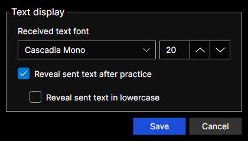

- **Received text font** és méret: a vételmező betűtípusa. Fix szélességű betűtípussal egymás alá kerülnek a csoportok; az alapértelmezett Cascadia Mono megkülönbözteti a `0`-t és az `O`-t.
- **Reveal sent text after practice:** ha semmit sem gépeltél, a kör végén a vételmezőbe bekerül az elküldött szöveg.
- **Reveal sent text in lowercase:** a felfedett szöveg kisbetűvel (a prosignok változatlanok maradnak).

## 9. Elemzés: trendek, korreláció, tévesztések

Mindhárom ablak a **mentett** köreidből dolgozik.

### Trendek (Trends)

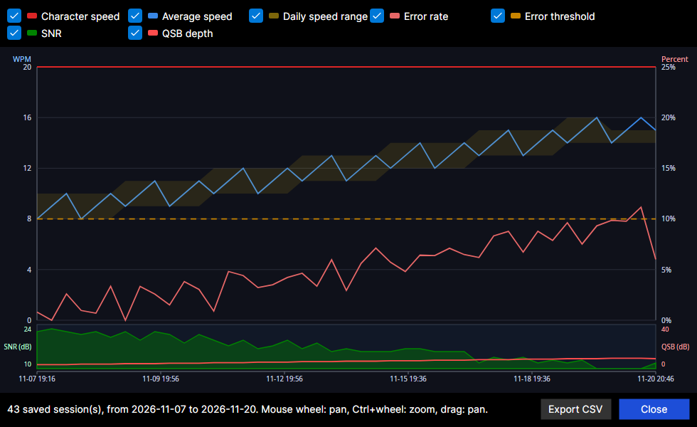

Minden mentett kör egy időtengelyen:

- felső grafikon, bal tengely (WPM): **karaktersebesség**, **átlagsebesség**, és a sávként satírozott **napi sebességtartomány**: minden napra az aznapi **sikeres** körök leglassabb és leggyorsabb átlagsebessége között (azokon a napokon, ahol nem volt sikeres kör, nincs sáv);
- felső grafikon, jobb tengely (%): **hibaarány** és **hibaküszöb** (minden kör a saját küszöbével);
- alsó sáv: **SNR** és **QSB-mélység**.

Minden görbe kikapcsolható a jelölőnégyzetével. Az egérgörgő görget, a Ctrl + görgő nagyít, húzással is görgethetsz. Az **Export CSV** minden kört CSV-fájlba ment a saját táblázataidhoz.

### Korreláció (Correlation)

Mitől hibázol? A korrelációs ablak három fülön válaszol erre. Mindegyik minden mentett körhöz egy pontot rajzol: a hibaarányt a **sebesség**, a **jel/zaj viszony** (csak a zajos körök) vagy a **QSB-mélység** (csak a QSB-s körök) függvényében.

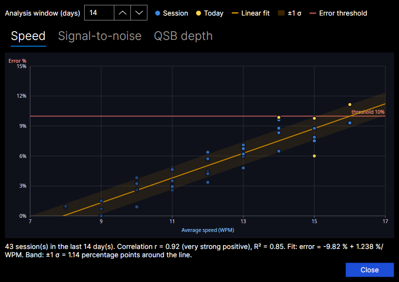

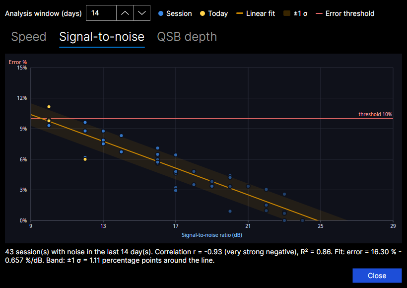

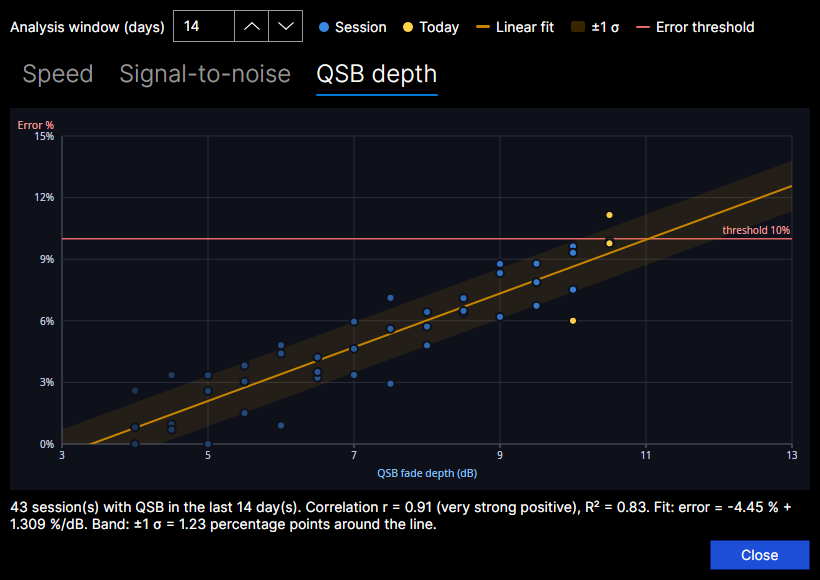

Hogyan olvasd:

- **Analysis window (days):** hány napra visszamenőleg nézze; a **0 csak a mai napot mutatja** (éjféltől). A három fül közös értéke, a program megjegyzi.
- **Pontok:** a kék pontok a korukkal halványulnak (az ablak legrégebbi köre a leghalványabb); a **mai** körök **sárgák**. Ha egy pont fölé viszed az egeret, látod az időpontját, az értékét és a hibaarányát.
- **Linear fit** (borostyánszínű egyenes): a hibaarány legkisebb négyzetes egyenese a mennyiség függvényében; a satírozott **±1 σ** sávba esik a körök nagyjából kétharmada.
- **Error threshold** (piros vonal): a jelenleg beállított hibaküszöb.
- **Összefoglaló** a grafikon alatt: a körök száma, a Pearson-féle korrelációs együttható, **r** (−1…1, szóban is minősítve), az **R²** (az egyenes a szórás mekkora részét magyarázza), és az egyenes egyenlete: például az `error = 17.94 % − 0.702 %/dB` azt jelenti, hogy minden dB-nyi jobb jel/zaj viszony körülbelül 0,7 százalékponttal kevesebb hibát jelent.

Az egyeneshez legalább két kör kell, eltérő értékekkel és eltérő hibaaránnyal; ha ez nincs meg, az összefoglaló megmondja, miért nincs egyenes.

### Tévesztések (Confusions)

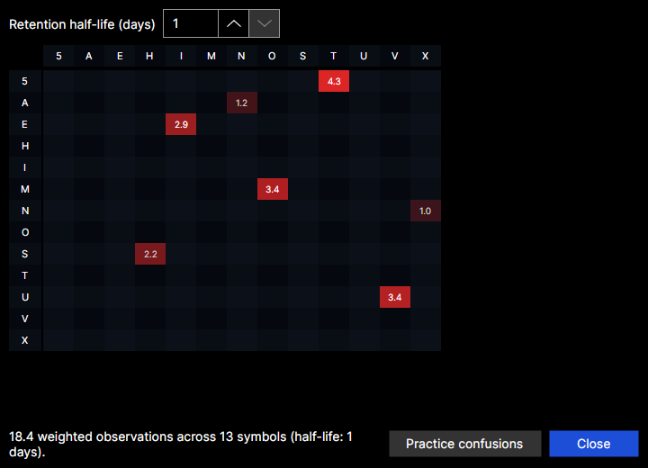

Mely karaktereket kevered össze? A sorok a **küldött** karakterek, az oszlopok az, amit helyettük **gépeltél**; a cellában lévő szám azt mutatja, milyen gyakran, a koruk szerint súlyozva. A **Retention half-life (days)** (felezési idő) adja meg, milyen gyorsan halványulnak a régi hibák: egy ennyi napos tévesztés feleannyit számít.

A **Practice confusions** a legtöbbször tévesztett karaktereidből készít egy *Practice confusions* nevű karakterkészletet, kiválasztja, és véletlen csoportokra váltja a témát, így a következő kör pontosan ezeket gyakoroltatja.

## 10. Mentés: export, import, visszaállítás

- **File › Export:** a beállításaidat és minden mentett körödet egyetlen `.prmt` fájlba menti (`pentagrammata-backup-ÉÉÉÉ-HH-NN.prmt`). Az ablakméretek nem kerülnek bele.
- **File › Import:** ilyen fájlt tölt be, bármelyik gépen. Ellenőrzi a fájlt, megerősítést kér, aztán **azonnal**, újraindítás nélkül lecseréli a beállításokat és a statisztikát. Mielőtt bármit lecserélne, a jelenlegi adataidat elmenti a profilod `backups` mappájába, és megmondja, hová.
- **File › Restore:** visszahozza a legutóbbi import előtt elmentett adatokat (a lecserélt adatokat pedig egy újabb mentésben megőrzi).

## 11. Frissítések és a Névjegy ablak

A **Help › Check updates** megkérdezi a GitHubot, van-e újabb stabil kiadás. A **Help › About** megmutatja a verziót, a funkciókat és a licencet:

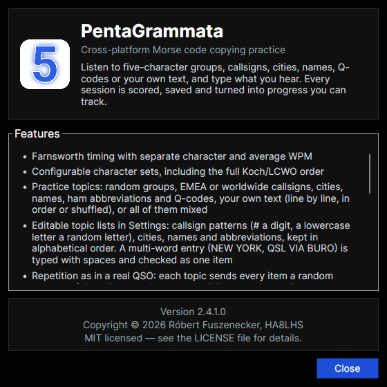

## 12. Egy edzésterv

1. Állítsd a **karaktersebességet** a célodra (20–25 WPM), az **átlagsebességet** jóval alá (10–15 WPM).
2. Kezdd a **Koch-LCWO-01-KM** készlettel és **10 %-os hibaküszöbbel**.
3. Gyakorolj 5 perces körökben, és mindegyiket **mentsd**. Ha már megbízhatóan sikeresek, lépj a következő Koch-szintre.
4. Kapcsold be az **Auto-adjust WPM**-et 3-as ablakkal: az átlagsebesség követni fogja a formádat.
5. Ha a betűk már biztosan mennek, válts **hívójelekre**, **nevekre** és **rövidítésekre**: ezeket fogod hallani az éterben.
6. Kapcsold be a **zajt** (Pink, kb. 15 dB SNR) és a **QSB**-t, és hagyd, hogy az **auto-adjust SNR / QSB depth** fokozatosan nehezítse a körülményeket.
7. Hetente nézd meg a **korrelációs** ablakot: az egyenes meredeksége megmutatja, hogy a sebesség vagy a zaj a gyenge pontod, a **Confusions** ablak pedig azt, mely karaktereket kell gyakorolnod.

---

## 13. A motorháztető alatt: a kód

A PentaGrammata egy .NET 10 / [Avalonia](https://avaloniaui.net) asztali alkalmazás, MVVM mintában írva. Ez a fejezet megmutatja, hogy amit fent láttál, az hol található a forráskódban.

### Fordítás és tesztelés

```bash
dotnet build src/PentaGrammata.csproj
dotnet run --project src/PentaGrammata.csproj
# unit tesztek
dotnet test tests/PentaGrammata.Tests/PentaGrammata.Tests.csproj
# a teljes felület, fejnélküli módban
dotnet test tests/PentaGrammata.Headless.Tests/PentaGrammata.Headless.Tests.csproj
```

A headless tesztek úgy kezelik a valódi ablakokat, ahogy egy felhasználó: kattintanak, gépelnek, dialógusokat nyitnak, képkockákat renderelnek. A kézikönyv képeit is egy ilyen teszt készíti (lásd [docs/README.md](../README.md)).

### A rétegek

```
src/
  Views/           az Avalonia AXAML ablakok és vékony code-behindjuk
  ViewModels/      az ablakok állapota és parancsai (CommunityToolkit.Mvvm)
  Presentation/    dialógusok, fájlválasztók és ablakok megnyitása
  Services/        az üzleti logika
  Players/         hang: morze-renderelés, lejátszók, zaj, jelfeldolgozás
  Stores/          tárolás: beállítások, statisztikai adatbázis, ablakméretek
  Interfaces/      az absztrakciók, amelyeken át minden injektálódik
  Models/          egyszerű adatrekordok
  Configuration/   a beállításosztályok (ami a settings.prmt-ben van)
  Composition/     a dependency injection regisztrációja
tests/
  PentaGrammata.Tests/           unit tesztek (MSTest + NSubstitute)
  PentaGrammata.Headless.Tests/  forgatókönyvek a valódi felületen
```

Minden szolgáltatás a `Composition/ServiceCollectionExtensions.cs`-ben van regisztrálva; a konténer az `App.axaml.cs`-ben épül fel (ugyanitt kényszeríti ki a program a sötét témát). Egy view model sosem nyúl közvetlenül tárolóhoz, csak interfészeken keresztül szolgáltatásokhoz.

### A főablaktól az eredményig

| Amit látsz | Hol van |
|------|--------------|
| Főablak, menü, állapotsor | `Views/MainWindow.axaml`, `ViewModels/MainWindowViewModel.cs`, `ViewModels/PracticeViewModel.cs` |
| Practice gomb, visszaszámlálás, Check result | `PracticeViewModel` → `Services/PracticeController.cs` |
| A kör szövege | a `Services/PracticeTextGeneratorFactory.cs` választja ki a téma generátorát; a csoportok az `IMorseGenerator`-ból jönnek, a hívójelek a mintákból, az ismétlés és a többszavas tételek összefűzése a `Services/PracticeItems.cs`-ből |
| Morze-hang | a `Players/MorsePlayer.cs` Farnsworth-időzítéssel rendereli a hangot (`MorseSignalRenderer`), hozzáadja a QSB-t (`QsbFader`), a zajt, a sáváteresztő szűrőt, az AGC-t és az APF-et (`BandPassFilter`, `AutomaticGainControl`, a zajgenerátorok); az `AudioPlayerFactory` választja ki a `WindowsAudioPlayer`-t (NAudio), a `LinuxAudioPlayer`-t vagy a `MacOSAudioPlayer`-t |
| Torzításfigyelmeztetés a beállításokban | `Services/AudioHeadroomAnalyzer.cs` |
| Kiértékelés | `Services/PracticeResultEvaluator.cs`: tételenkénti Levenshtein-távolság és a diff szakaszai; a `Services/ConfusionObservationExtractor.cs` a mentett kör hibáiból tévesztési megfigyeléseket készít |
| Eredményablak | `Views/PracticeResultWindow.axaml`, `ViewModels/PracticeResultWindowViewModel.cs` |
| Egy kör mentése | `Stores/PracticeResultStatisticsStore.cs` (SQLite, `practice-results.db`) az `IPracticeResultStatisticsService` mögött |
| Auto-adjust | a `PracticeController.RecordSavedResult` a `Services/DynamicDifficultyAdjuster.cs`-től kér egy nehezebb/könnyebb döntést, és mozgatja a WPM-et, az SNR-t és a QSB-mélységet |

Egy kör egy mondatban: a `PracticeController.StartAsync` szöveget kér a téma generátorától, szétválasztja arra, ami **elhangzik** (minden ismétlés), és arra, ami **ellenőrzésre** kerül (minden tétel egyszer), az elhangzó szöveget átadja a `MorsePlayer`-nek a kör sebességével és vevőszintjeivel, az ellenőrzendőt pedig megtartja a `BuildResultAsync` számára, amelynek eredményét az eredményablak mutatja és menti.

### Beállítások és tárolás

| Mi | Hol |
|------|--------------|
| Beállításosztályok | `Configuration/` (`AppConfiguration`, `Practice`, `Audio`, `NoiseSettings`, `Topics`, `Analytics`, `UiPreferences`); minden tulajdonságnak van `[PromptuariumComment]` megjegyzése a mértékegységével |
| A `settings.prmt` betöltése és mentése | `Stores/ConfigurationStore.cs`; a beépített alapértékek a `src/settings.prmt`-ben vannak, a saját fájlod ezekre rétegződik |
| Az élő beállítások | `Services/ConfigurationService.cs` (`IConfigurationService.Current`) |
| Ellenőrzés | `Services/PracticeSettingsValidator.cs` |
| Morze-beállítások dialógus | `Views/MorseSettingsDialog.axaml`, `ViewModels/MorseSettingsDialogViewModel.cs` |
| Ablakméretek | `Stores/WindowSizeStore.cs` (`windows.prmt`) |
| Export, import, visszaállítás | `Services/UserBackupService.cs`, `Services/BackupArchive.cs` (a PPAK1-LE archívumformátum) |

### Elemzés

| Ablak | View model | Elemzés | Grafikon |
|---|-----|------|-----|
| Trends | `TrendsDialogViewModel` | a napi sebességtartomány a view modelben; a CSV a `Services/PracticeStatisticsCsvExporter.cs`-ben | `Views/Controls/TrendsTimelineChart.cs` |
| Correlation | `CorrelationDialogViewModel` + fülenként egy `CorrelationTabViewModel` | `Services/CorrelationAnalysisService.cs` (ablak, legkisebb négyzetek, Pearson r, reziduális σ) `CorrelationAxis`-onként | `Views/Controls/CorrelationScatterChart.cs` |
| Confusions | `ConfusionsDialogViewModel` | `Services/ConfusionAnalysisService.cs` (felezési idős súlyozás, a *Practice confusions* készlet) | cellarács a `Views/ConfusionsDialog.axaml`-ben |

A grafikonok saját Avalonia vezérlők, amelyek `DrawingContext`-tel rajzolnak; az elemző szolgáltatások a mentett rekordok tiszta függvényei, ezért felület nélkül, unit tesztekkel ellenőrizhetők.

### Hol olvass tovább

- `AGENTS.md` a repó gyökerében: minden funkció pontos szabályai (ez a specifikáció, amit a kód követ).
- `README.md`: a beállítások teljes táblázata alapértékekkel és mértékegységekkel.
- `RELEASE_NOTES.md`: mi változott az egyes verziókban.
